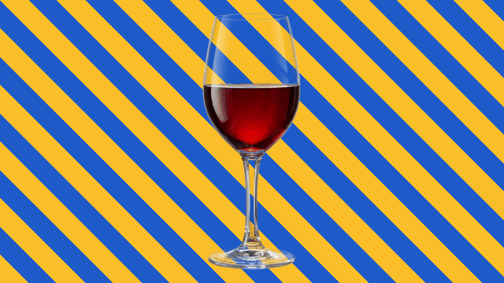
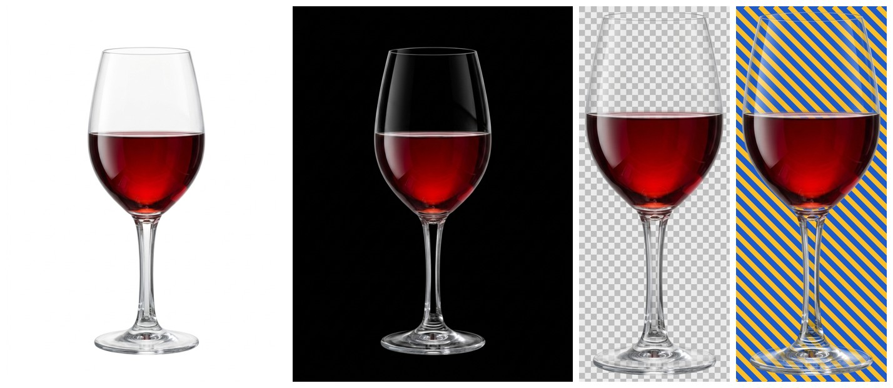
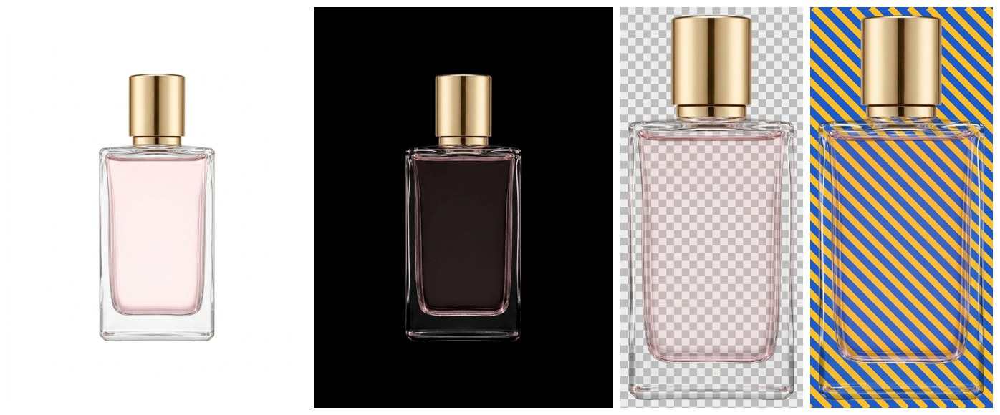
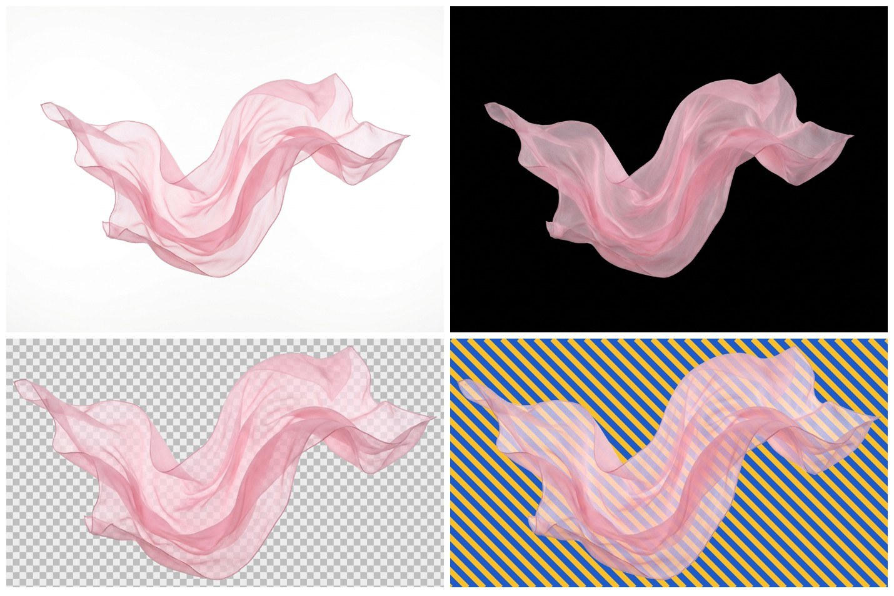

# agy-atelier

[](https://github.com/uzzzzy/agy-atelier/actions/workflows/test.yml)
[](https://github.com/uzzzzy/agy-atelier/releases)
[](LICENSE)

**The Google Antigravity CLI (`agy`) inside Claude Code.** A Claude Code plugin with one skill, `agy-cli`,
that lets Claude hand work to `agy`:

- **Generate images** from text, in 7 aspect ratios, with 1–4 variations per run.
- **Edit or combine images**: pass up to 3 reference images.
- **Transparent and semi-transparent PNGs**: glass, liquids, sheer fabric, smoke and veils come out with real
  partial alpha, not a hard cut-out.
- **Headless prompts** on Antigravity's models (Gemini, Claude, GPT-OSS) for second opinions or delegated tasks.



*The PNGs above were generated by `agy` and cut out with this plugin. The stripes move behind them, and the
glass, perfume and chiffon stay see-through.*

You ask in plain language ("make a transparent PNG of a wine glass for the landing page"), and Claude runs the
bundled script, checks the result and saves it where your project needs it.

## What sets it apart

- **Only the official `agy` CLI.** It doesn't read Antigravity's local database or tokens and doesn't call
  undocumented endpoints.
- **Transparency that keeps glass looking like glass.** Two-plate difference matting, with automatic plate
  alignment, quality checks and retries.
- **Hardened runs:**
  - agy runs in a throwaway folder with its terminal sandbox on;
  - the user's prompt is fenced off from the agent's instructions;
  - a hard timeout stops hung runs, including agy's helper processes;
  - a version check warns when agy updates itself past what was tested;
  - quota is checked before big batches.
- **Zero setup.** numpy and Pillow install themselves into a private venv on first use.
- **Tested on Linux, macOS and Windows**, offline, against a fake `agy`.

## Requirements

- Python 3.9+ on macOS, Linux or Windows
- The Antigravity CLI (`agy`), installed and signed in (run `agy` once interactively). Tested with 1.3.4–1.4.5.
- Claude Code

## Install

**As a Claude Code plugin** (recommended):

```
/plugin marketplace add uzzzzy/agy-atelier
/plugin install agy-cli@agy-atelier
```

**Manually** (copies the skill to `~/.claude/skills/agy-cli`):

```bash
git clone https://github.com/uzzzzy/agy-atelier.git
cd agy-atelier
python3 install.py          # --link to symlink while developing, --force to replace, --no-setup to skip deps
```

On Windows, run `py install.py`. Use one install method, not both, or Claude will see the skill twice.

## Usage

Just ask Claude, for example:

- "Generate a 16:9 hero image of a cozy workspace for `public/images/hero.png`"
- "Edit `photo.jpg` so the mug is matte black"
- "Give me 3 icon variations of a paper airplane"
- "Make a transparent PNG of a floating sheer pink scarf"
- "Ask Gemini through agy to review this function"

The script can also be used directly:

```bash
IMG=skills/agy-cli/scripts/agy_image.py

python3 $IMG generate "A cozy minimalist workspace, soft morning light" -o out/hero.png --ratio 16:9
python3 $IMG generate "Make the mug matte black, keep everything else" --ref photo.jpg -o out/
python3 $IMG generate "Flat vector app icon of a paper airplane" -n 3 -o out/icons/
python3 $IMG transparent "A clear crystal wine glass half filled with red wine" -o out/wine.png --trim
python3 $IMG transparent "same product" --white product_on_white.jpg -o out/product.png
python3 $IMG matte --white a_white.jpg --black a_black.jpg -o out/a.png
python3 $IMG transparent "a soap bubble" --dry-run     # show the plan, run nothing
```

Each command prints one JSON object on stdout:

- the output paths;
- quality metrics, for transparent output;
- `agy_runs`, with the seconds and token usage of each agy run.

An image takes about 40–90 seconds. See [`skills/agy-cli/SKILL.md`](skills/agy-cli/SKILL.md) for every option.

## How transparency works

Image models can't output an alpha channel, so `transparent` makes two **plates** and solves for alpha:

1. Generate the subject on flat pure white.
2. Use that image as a reference and have it edited onto flat pure black, with the subject unchanged.
3. Over a background of level `k`, each pixel is `P = a·C + (1 − a)·k`, so with both plates
   `a = 1 − (P_white − P_black)`, and the colour `C` follows from either plate.

| Wine glass | Perfume bottle | Sheer chiffon scarf |
|---|---|---|
|  |  |  |

*Each sheet shows the white plate, the black plate, the PNG on a checkerboard, and the PNG over stripes.*

This is classic difference (triangulation) matting. Unlike background removers, it keeps glass, liquid and thin
fabric see-through. The script:

- aligns small shifts between the plates;
- checks background purity and whether the two plates still match;
- regenerates the black plate when a check fails;
- writes `NAME.png`, a checkerboard `NAME.preview.png` and both plates, so you can re-matte without generating
  again.

**Limits:** a PNG has a single alpha per pixel, so strongly tinted glass keeps an averaged tint, and the edit
pass can change tiny details. Always look at the preview.

## Configuration

| Variable | Default | Purpose |
|---|---|---|
| `AGY_IMAGE_MODEL` | `gemini-3.8-flash-low` | agy model that orchestrates image runs (`agy models` lists them) |
| `AGY_IMAGE_SANDBOX` | `1` | `0` runs agy without its terminal sandbox (same as `--no-sandbox`) |
| `AGY_IMAGE_VENV` | `~/.local/share/agy-atelier/venv` | Where numpy + Pillow are installed |
| `AGY_IMAGE_NO_AUTO_SETUP` | unset | `1` disables the automatic install; run `agy_image.py setup` yourself |
| `AGY_SKIP_VERSION_CHECK` | unset | `1` skips the `agy --version` check |
| `AGY_BIN` | `agy` on `PATH`, else `~/.local/bin/agy` | agy executable |
| `AGY_BRAIN_DIR` | `~/.gemini/antigravity-cli/brain` | Where agy stores conversation artifacts |
| `CLAUDE_SKILLS_DIR` | `~/.claude/skills` | Target folder for `install.py` |

## Windows

The plugin and the script are cross-platform, and the test suite runs on Windows in CI. Two caveats:

- agy's terminal sandbox needs Windows 11 24H2 or later. On older systems the script retries without it and says so.
- The author verifies real agy runs on macOS; on Windows only the offline tests run. Please open an issue if a
  real run misbehaves.

## A note on safety

`agy` is a full agent. If `toolPermission` in `~/.gemini/antigravity-cli/settings.json` is `always-proceed`,
headless runs execute commands and edit files without asking. To limit that, the image script:

- runs agy in a throwaway temp folder with `--sandbox`;
- marks your prompt as a picture description only;
- tells agy not to touch files.

The skill instructs Claude to apply the same care to other agy tasks.

## Development

```bash
python3 -m venv .venv
.venv/bin/pip install -r requirements-dev.txt
.venv/bin/python -m pytest -q
.venv/bin/python docs/make_demo.py     # rebuild docs/images/demo.gif
```

The tests use a fake `agy`, so they need no network or Antigravity account.
See [CHANGELOG.md](CHANGELOG.md) for release notes.

## License

[MIT](LICENSE). Not affiliated with Google or Anthropic. Generated images are subject to the terms of the
Antigravity service you use.
